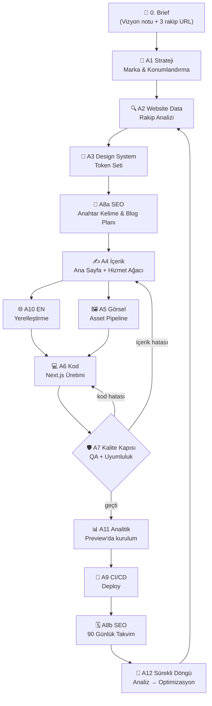
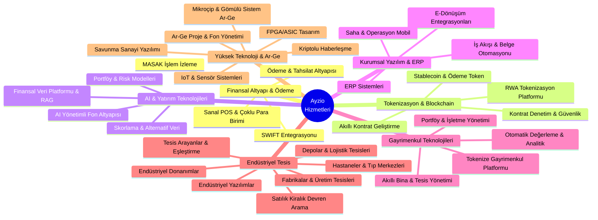
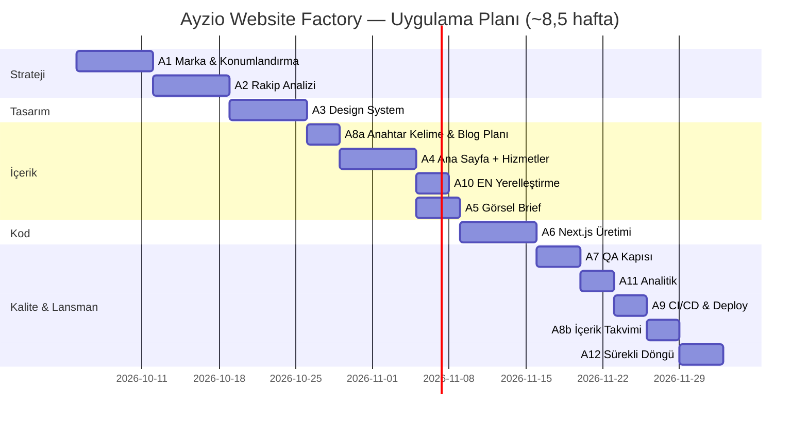

# Ayzio Technology — AI Website Factory

## Master Prompt + Ajan Zinciri Mimarisi (Revize Sürüm v1.1)

Bu doküman, Ayzio Technology'nin kurumsal web varlığını **brief'ten canlıya** tek bir koordineli AI ajan zinciriyle üretmek için gereken her şeyi içerir: paylaşılan bağlam objesi, kopyala-yapıştır master prompt, 12 detaylı ajan promptu, kalite kapıları, takvim ve KPI'lar.

> **v1.1 revizyon özeti:** ajan numaraları ve çalışma sırası tüm bölümlerde tekleştirildi; dil kapsamı TR/EN'e sabitlendi (AR → yol haritası); trust signal'ler "sahip olunan / doğrulanacak / uyumlu altyapı" olarak ayrıldı; kontrast kriteri düzeltildi (açık zemin için `#007A99`); SEO anahtar kelime araştırması içerikten önceye alındı; analitik deploy'dan önceye alındı; Endüstriyel Tesis pazar yeri için kapsam sınırı eklendi; AyzioContext'e `strategy`, `analytics`, `localization` bölümleri eklendi; yazım hataları giderildi.

---

## 1. Mimari Genel Bakış

Zincir 12 ajandan oluşur. Her ajan **AyzioContext** adlı paylaşılan JSON objesini okur, kendi çıktısıyla zenginleştirir ve bir sonraki ajana devreder. Böylece marka tutarlılığı ve izlenebilirlik baştan sona korunur. Ajan numaraları (A1–A12) tüm dokümanda aynı ajanı ifade eder; **çalışma sırası numara sırası değildir** — aşağıdaki akış geçerlidir.



**Temel prensipler:**

1. **Tek kaynak:** Tüm ajanlar aynı AyzioContext'i okur — tutarsızlık imkânsızlaşır.
2. **Kalite kapısı:** Kod üretilmeden önce içerik ve uyumluluk onayı zorunludur; kapı geçilemezse zincir hatanın türüne göre A4'e (içerik) veya A6'ya (kod) döner.
3. **Döngüsel yaşam:** Lansman sonrası zincir kapanmaz; A2 periyodik olarak rakip analizini tazeler.

---

## 2. AyzioContext — Paylaşılan Durum Objesi

Bu obje zincirin "beynidir". Her ajan çalışmadan önce bunu yükler, çalıştıktan sonra kendi bölümünü günceller.

```json
{
  "version": "1.1.0",
  "brand": {
    "name": "Ayzio Technology",
    "positioning": "AI-native finansal altyapı ve tokenizasyon sağlayıcısı",
    "tone": "kurumsal, güven veren, teknik ama erişilebilir",
    "languages": ["TR", "EN"],
    "languages_roadmap": ["AR — RTL düzen + A10 kapsamına AR eklenmesi gerekir (Faz 3)"],
    "palette": {
      "primary_navy": "#0A0E27",
      "accent_cyan": "#00D4FF",
      "accent_cyan_on_light": "#007A99",
      "accent_gold": "#F5B301",
      "neutral": "#FFFFFF",
      "surface_dark": "#111535"
    },
    "typography": { "heading": "Space Grotesk", "body": "Inter" },
    "trust_signals": {
      "rule": "Sitede yalnız 'held' listesindekiler sertifika/belge olarak gösterilir. Diğerleri 'uyumlu altyapı', 'entegrasyon' veya 'yol haritası' diliyle yazılır.",
      "held": [],
      "to_verify": ["ISO 27001", "SOC2"],
      "compliant_by_design": ["KVKK", "GDPR", "MASAK", "SPK"],
      "integrations": ["SWIFT (MT/MX, ISO 20022)"],
      "programs": ["TÜBİTAK 1501/1507", "SSB"]
    }
  },
  "services": {
    "structure": "2 seviye: ust_kategori → alt_hizmet. URL şeması: /hizmetler/{kategori}/{alt-hizmet}",
    "categories": [
      {
        "id": "fin-infrastructure",
        "name": "Finansal Altyapı & Ödeme",
        "name_en": "Financial Infrastructure & Payments",
        "icon": "tbd", "slug": "finansal-altyapi",
        "subservices": [
          { "id": "swift", "name": "SWIFT Entegrasyonu (MT/MX, ISO 20022)", "name_en": "SWIFT Integration (MT/MX, ISO 20022)", "icon": "tbd", "slug": "swift-entegrasyon" },
          { "id": "payment-rails", "name": "Ödeme & Tahsilat Altyapısı (havale/EFT, çekim)", "name_en": "Payment & Collection Rails", "icon": "tbd", "slug": "odeme-tahsilat" },
          { "id": "virtual-pos", "name": "Sanal POS & Çoklu Para Birimi", "name_en": "Virtual POS & Multi-Currency", "icon": "tbd", "slug": "sanal-pos" },
          { "id": "masak-monitoring", "name": "MASAK Uyumlu İşlem İzleme & Raporlama", "name_en": "MASAK-Compliant Transaction Monitoring", "icon": "tbd", "slug": "masak-islem-izleme" }
        ]
      },
      {
        "id": "tokenization-blockchain",
        "name": "Tokenizasyon & Blockchain",
        "name_en": "Tokenization & Blockchain",
        "icon": "tbd", "slug": "tokenizasyon-blockchain",
        "subservices": [
          { "id": "rwa-platform", "name": "RWA Tokenizasyon Platformu (ihraç → ikincil piyasa)", "name_en": "RWA Tokenization Platform", "icon": "tbd", "slug": "rwa-tokenizasyon" },
          { "id": "stablecoin", "name": "Stablecoin & Ödeme Token Altyapısı", "name_en": "Stablecoin & Payment Token Infrastructure", "icon": "tbd", "slug": "stablecoin" },
          { "id": "smart-contracts", "name": "Akıllı Kontrat Geliştirme (EVM + Hyperledger)", "name_en": "Smart Contract Development (EVM + Hyperledger)", "icon": "tbd", "slug": "akilli-kontratlar" },
          { "id": "contract-audit", "name": "Kontrat Denetim & Güvenlik Testleri", "name_en": "Contract Audit & Security Testing", "icon": "tbd", "slug": "kontrat-denetim" }
        ]
      },
      {
        "id": "ai-capital",
        "name": "AI & Yatırım Teknolojileri",
        "name_en": "AI & Investment Technologies",
        "icon": "tbd", "slug": "ai-yatirim-teknolojileri",
        "subservices": [
          { "id": "ai-funds", "name": "AI Yönetimli Yatırım Fonu Altyapısı", "name_en": "AI-Managed Investment Fund Infrastructure", "icon": "tbd", "slug": "ai-fon-altyapisi" },
          { "id": "portfolio-risk", "name": "Algoritmik Portföy & Risk Modelleri", "name_en": "Algorithmic Portfolio & Risk Models", "icon": "tbd", "slug": "portfoy-risk-modelleri" },
          { "id": "data-platform", "name": "Finansal Veri Platformu & RAG Asistanları", "name_en": "Financial Data Platform & RAG Assistants", "icon": "tbd", "slug": "finansal-veri-platformu" },
          { "id": "scoring", "name": "Skorlama & Alternatif Veri Modelleri", "name_en": "Scoring & Alternative Data Models", "icon": "tbd", "slug": "skorlama-modelleri" }
        ]
      },
      {
        "id": "enterprise-software",
        "name": "Kurumsal Yazılım & ERP",
        "name_en": "Enterprise Software & ERP",
        "icon": "tbd", "slug": "kurumsal-yazilim",
        "subservices": [
          { "id": "erp", "name": "ERP Sistemleri (finans, stok, tedarik, İK/bordro)", "name_en": "ERP Systems", "icon": "tbd", "slug": "erp" },
          { "id": "e-transformation", "name": "E-Dönüşüm (e-fatura, e-defter, entegrasyonlar)", "name_en": "E-Transformation (e-invoice, e-ledger)", "icon": "tbd", "slug": "e-donusum" },
          { "id": "bpm", "name": "İş Akışı & Belge Yönetimi Otomasyonu (BPM)", "name_en": "Workflow & Document Automation (BPM)", "icon": "tbd", "slug": "is-akisi-otomasyonu" },
          { "id": "field-ops", "name": "Saha & Operasyon Mobil Çözümleri", "name_en": "Field & Operations Mobile Solutions", "icon": "tbd", "slug": "saha-operasyon" }
        ]
      },
      {
        "id": "realestate-tech",
        "name": "Gayrimenkul Teknolojileri",
        "name_en": "Real Estate Technology (PropTech)",
        "icon": "tbd", "slug": "gayrimenkul-teknolojileri",
        "subservices": [
          { "id": "re-portfolio", "name": "Portföy & İşletme Yönetim Yazılımı (kira, tahsilat, bakım)", "name_en": "Portfolio & Facility Management Software", "icon": "tbd", "slug": "portfoy-isletme-yonetimi" },
          { "id": "re-valuation", "name": "Otomatik Değerleme & Piyasa Analitiği (AVM)", "name_en": "Automated Valuation & Market Analytics", "icon": "tbd", "slug": "otomatik-degerleme" },
          { "id": "re-token", "name": "Tokenize Gayrimenkul Yatırım Platformu", "name_en": "Tokenized Real Estate Investment Platform", "icon": "tbd", "slug": "tokenize-gayrimenkul" },
          { "id": "re-facility", "name": "Akıllı Bina, Enerji & Tesis Yönetimi (IoT entegre)", "name_en": "Smart Building, Energy & Facility Management", "icon": "tbd", "slug": "akilli-bina-tesis" }
        ]
      },
      {
        "id": "industrial-facility",
        "name": "Endüstriyel Tesis",
        "name_en": "Industrial Facilities",
        "icon": "tbd", "slug": "endustriyel-tesis",
        "subservices": [
          { "id": "ind-market", "name": "Satılık / Kiralık / Devren Tesis Arama Motoru (talep odaklı)", "name_en": "For-Sale / For-Lease / Turnkey Facility Search", "icon": "tbd", "slug": "satilik-kiralik-devren-tesis" },
          { "id": "ind-demand", "name": "Tesis Arayanlar — Talep İlanı & Arz-Talep Eşleştirme (\"Tesis Arıyorum\")", "name_en": "Facility Seekers — Demand Listings & Matching", "icon": "tbd", "slug": "tesis-ariyorum-eslestirme" },
          { "id": "ind-hospital", "name": "Hastaneler & Tıp Merkezleri (satılık / kiralık / devren)", "name_en": "Hospitals & Medical Centers", "icon": "tbd", "slug": "hastane-satilik-kiralik-devren" },
          { "id": "ind-factory", "name": "Fabrikalar & Üretim Tesisleri (satılık / kiralık / devren)", "name_en": "Factories & Production Facilities", "icon": "tbd", "slug": "fabrika-satilik-kiralik-devren" },
          { "id": "ind-warehouse", "name": "Depolar & Lojistik Tesisleri (satılık / kiralık / devren)", "name_en": "Warehouses & Logistics Facilities", "icon": "tbd", "slug": "depo-lojistik-tesisleri" },
          { "id": "ind-software", "name": "Endüstriyel Yazılımlar (MES/SCADA, bakım CMMS, enerji izleme)", "name_en": "Industrial Software (MES/SCADA, CMMS, Energy)", "icon": "tbd", "slug": "endustriyel-yazilimlar" },
          { "id": "ind-hardware", "name": "Endüstriyel Donanımlar (makine/ekipman, PLC/otomasyon, IoT, güvenlik)", "name_en": "Industrial Hardware (Machinery, PLC/Automation, IoT)", "icon": "tbd", "slug": "endustriyel-donanimlar" }
        ]
      },
      {
        "id": "deep-tech-defense",
        "name": "Yüksek Teknoloji, Ar-Ge & Savunma",
        "name_en": "Deep Tech, R&D & Defense",
        "icon": "tbd", "slug": "yuksek-teknoloji-arge",
        "subservices": [
          { "id": "microchip-rd", "name": "Mikroçip & Gömülü Sistem Ar-Ge (firmware, RTOS, donanım-yazılım entegrasyonu)", "name_en": "Microchip & Embedded Systems R&D", "icon": "tbd", "slug": "mikrocip-gomulu-sistem-arge" },
          { "id": "fpga-asic", "name": "FPGA/ASIC Tasarım & Hızlandırılmış Bilişim", "name_en": "FPGA/ASIC Design & Accelerated Computing", "icon": "tbd", "slug": "fpga-asic-tasarim" },
          { "id": "secure-comms", "name": "Kriptolu & Güvenli Haberleşme Modülleri", "name_en": "Cryptographic & Secure Communication Modules", "icon": "tbd", "slug": "guvenli-haberlesme" },
          { "id": "defense-software", "name": "Savunma Sanayi Yazılım Çözümleri (simülasyon, lojistik, komuta kontrol)", "name_en": "Defense Software Solutions", "icon": "tbd", "slug": "savunma-sanayi" },
          { "id": "iot-sensors", "name": "IoT & Sensör Sistemleri", "name_en": "IoT & Sensor Systems", "icon": "tbd", "slug": "iot-sensor" },
          { "id": "rd-projects", "name": "Ar-Ge Proje & Fon Yönetimi (TÜBİTAK 1501/1507, SSB süreçleri)", "name_en": "R&D Project & Grant Management", "icon": "tbd", "slug": "arge-proje-fon-yonetimi" }
        ]
      }
    ]
  },
  "tech_stack": {
    "frontend": "Next.js (güncel kararlı sürüm, ≥15) + Tailwind CSS + Framer Motion",
    "backend": "Node.js + Python (AI servisleri)",
    "blockchain": ["Ethereum", "Polygon", "Hyperledger"],
    "ai": "LLM + RAG + tasarım ajanı",
    "deploy": "Vercel (site) + AWS (AI/backend servisleri)"
  },
  "strategy": { "vision_note": "pending", "positioning": [], "segments": [], "differentiation": "pending" },
  "competitor_scan": { "status": "pending", "sources": [], "patterns": [] },
  "design_tokens": { "status": "pending" },
  "content": { "homepage": "pending", "category_pages": {}, "service_pages": {} },
  "assets": { "hero_bg": "pending", "icons": {}, "og_image": "pending", "favicon": "pending" },
  "code": { "status": "pending", "repo": "pending" },
  "compliance": { "checked_items": [], "pending_items": ["KVKK", "GDPR", "ISO27001", "SOC2", "MASAK", "SPK", "SSB", "trust_signal_verification"] },
  "seo": { "keywords": [], "keyword_page_map": {}, "blog_plan": [], "calendar": [] },
  "localization": { "en": "pending", "notes": [] },
  "analytics": { "events": [], "conversions": [], "dashboard": "pending" },
  "qa_log": []
}
```

### 2.1 Hizmet Ağacı — Okunur Şema (7 Üst Kategori / 33 Alt Hizmet)



**Hiyerarşi kuralları:**

- **Üst kategori sayfası** (`/hizmetler/{kategori}`): dikeyin vizyonu, alt hizmet gridi, ortak uyumluluk bandı, 1 CTA. Hizmet kartı burada 30–40 kelimeyle tanıtılır.
- **Alt hizmet sayfası** (`/hizmetler/{kategori}/{alt}`): problem → çözüm → teknik mimari → vaka → SSS → CTA. Uzun kuyruk SEO burada yakalanır.
- Ana sayfada **7 kategori kartı** gösterilir; 33 alt hizmet kategori sayfalarının içinde açılır. Ana sayfada 33 kart yerine 7 kart + "tümünü gör" navigasyonu bilişsel yükü düşürür.
- **Kategori sayfaları Faz 1'de**, alt hizmet sayfaları **Faz 1 (16 öncelikli) + Faz 2 (kalan 17)** olarak üretilir.

**"Mikroçip Yazılımları"nın yeniden tanımı:** Eski belirsiz başlık, "Yüksek Teknoloji, Ar-Ge & Savunma" çatısı altında net bir Ar-Ge dikeyine dönüştürüldü: mikroçip & gömülü sistem Ar-Ge (firmware, RTOS, donanım-yazılım entegrasyonu), FPGA/ASIC tasarım, kriptolu haberleşme, IoT/sensör sistemleri ve TÜBİTAK/SSB kaynaklı Ar-Ge proje yönetimi. Bu dikeyin hedef kitlesi kurumsal değil, **savunma sanayi ana yüklenicileri ve Ar-Ge fonu kullanan firmalardır** — sayfa dili ve CTA'ları da buna göre (demo değil, "işbirliği görüşmesine").

---

### 2.2 Endüstriyel Tesis Kategorisi — Detay Spec (Aranan Taraf Odaklı)

> **Kapsam sınırı:** Bu bölümün tamamı (arama motoru, eşleştirme, alarm, anonim mod, NDA'lı devren, TCO, 3D tur) bir web sitesi değil, **ayrı bir üründür** ve kendi backend, veri modeli, KVKK açık rıza akışı ve yol haritasını gerektirir. Web sitesi (A4/A6) kapsamında yalnızca şunlar üretilir: kategori + segment landing sayfaları, programatik SEO landing şablonu ve "Tesis Arıyorum" talep formu (form → CRM/e-posta, KVKK aydınlatma + açık rıza). Geri kalan özellikler "Endüstriyel Tesis Platformu" ürün yol haritasına (Faz 3) taşınır; aşağıdaki spec o ürünün girdisidir.

**Temel tasarım kararı:** Platform iki taraflı bir pazar yeridir ama birincil kullanıcı **tesis satan değil, TESİS ARAYAN taraftır**: üretim firması, lojistik operatörü, ihracatçı, yatırımcı. Arz tarafı (mal sahibi/danışman) portföy yükler; UX, SEO, filtre mimarisi ve CTA hiyerarşisi **arayan için** tasarlanır. Satıcı akışı ikincil CTA'dır.

**A. Arayan tarafı özellikleri (birincil)**

1. **Fiziksel parametre araması** — endüstriyel tesis "m² + fiyat" ile değil, üretim parametreleriyle aranır:
  - Brüt/net m² (kapalı alan), arazi m²
  - Tavan yüksekliği (m) ve kolon aralığı
  - Kaldırma: vinç var/yok + kapasite (ton), forklift erişimi
  - Elektrik: bağlı güç (kW/kVA), trafo durumu, jeneratör
  - Doğalgaz, atık su/çeşme suyu altyapısı
  - Yükleme: rampa sayısı, dok kapısı, TIR/manevra alanı
  - Statü: OSB içinde mi, serbest bölge, imar durumu (sanayi/ticari)
2. **Harita + yarıçap arama:** OSB sınırları overlay (kaynak: Sanayi ve Teknoloji Bakanlığı / OSBÜK verisi — lisans ve güncellik doğrulanmalı); yakın OSB/liman/otoyol mesafesi otomatik hesaplanır
3. **Eşleşme skoru:** sonuç kartında "neden sana uygun" rozeti (ör. "Bağlı güç 800 kW — ihtiyacın 500 kW ✓")
4. **Kayıtlı arama + alarm:** yeni portföy girdiğinde e-posta/WhatsApp bildirimi
5. **Ters ilan — "Tesis Arıyorum" (fark yaratan özellik):** Arayan, istediği profili (sektör, m², güç, bölge, bütçe, tarih) ilan olarak açar; sistem portföyle **otomatik eşleştirir**, eşleşme yoksa danışman devreye girer. Bu, arzı beklemeden talep başlatmayı sağlar
6. **Anonim arama modu:** Arayan firma (rakiplerine görünmeden) arama yapar; iletişim bilgisi yalnız kendi talebini açtığında paylaşılır. Kurumsal gizlilik = pazar yerinde güven
7. **Karşılaştırma sepeti:** 3 tesisi yan yana tabloda kıyas (kW/m², €/m², mesafe)
8. **TCO hesaplayıcı:** kira + enerji + işçiliğe erişim + lojistik maliyeti → "toplam yerleşme maliyeti" tahmini

**B. Arz tarafı (ikincil):** portföy yükleme sihirbazı (tapu, iskan, OSB izin dokümanları), 3D sanal tur, "portföyüne X anonim talep geldi" sinyal panosu.

**C. Arama motoru mimarisi**

- **Faceted search:** her filtre URL parametresine yazılır → SEO landing matrisi: `şehir × işlem (satılık/kiralama) × tip (fabrika/depo/OSB/atölye)` — ör. `/endustriyel-tesis/kiralama/bursa-osb/vincli-fabrika`
- **Doğal dil arama (LLM):** "Bursa'da 1000 m² üzeri, vinçli, doğalgazlı fabrika kiralama" cümlesi → filtre setine dönüştürülür
- **Eşleştirme algoritması:** ağırlıklı benzerlik (güç %25, m² %20, bölge %20, statü %15, bütçe %10, altyapı %10) — ağırlıklar admin panelinden kalibre edilir

**D. Tesis veri şeması (A6'da `types/facility.ts` olarak üretilir)**

```json
{
  "id": "fac-001",
  "type": "fabrika",
  "listing": "kiralama",
  "city": "Bursa", "district": "Nilüfer", "osb": "Nilüfer OSB",
  "area_closed_m2": 2400, "area_land_m2": 5000,
  "ceiling_height_m": 9, "column_spacing_m": 12,
  "crane": { "exists": true, "capacity_ton": 10 },
  "power": { "connected_kw": 800, "transformer": "mevcut", "generator": true },
  "natural_gas": true, "loading": { "docks": 4, "ramps": 2 },
  "status": "OSB", "zoning": "sanayi",
  "price": { "amount": 165000, "currency": "EUR", "period": "ay" },
  "match_keywords": ["vinçli", "800 kW", "OSB"],
  "docs": ["tapu", "iskan", "osb-izin"],
  "tour_3d": "url"
}
```

**E. SEO — arayan niyetine göre**

- Anahtar kelimeler satana değil arayana göre: "fabrika kiralama \[şehir\]", "vinçli atölye kiralama", "OSB içinde depo", "endüstriyel tesis satılık \[bölge\]", "serbest bölge depo kiralama", "yüksek tavanlı üretim tesisi"
- Şehir × işlem × tip matrisi programatik landing üretir; her sayfada gerçek portföy sayısı + "X tesis bu kriterde" dinamik başlık
- "Tesis Arıyorum" talep ilanı sayfası ayrıca hedeflenir — rakip pazar yerlerinde olmayan talep-taraflı içerik = SEO farkı

**F. CTA hiyerarşisi**

1. **Primary:** "Tesisini Ara" → filtreli arama ekranı
2. **Primary-2:** "Tesis Arıyorum" → talep ilanı formu (3 adım, ≤90 saniye)
3. **Secondary:** "Portföyünü Ekle" (arz tarafı — sayfanın alt bandında)

**G. Metrikler (A11 event şemasına bağlanır)**

- Huni: `search_start → filter_apply → facility_view → tour_3d_view → demand_submit`
- Denge metrikleri: talep ilanı sayısı / portföy ilanı sayısı oranı (hedef ≥1.2 — platform talep-taraflı olduğunu sayıyla kanıtlar), eşleşme oranı (talep → 30 gün içinde eşleşen %), anonim arama kullanım oranı

**H. Sektörel segmentler & devren kurgusu (7. kategorinin omurgası)**

Pazar yeri tek tip "tesis" değil, **segment bazlı** çalışır. Her segmentin kendi parametre seti, arama filtresi ve SEO matrisi vardır:

1. **Hastaneler & Tıp Merkezleri:** yatak sayısı, poliklinik/ameliyathane sayısı, radyoloji kurşun koruma durumu, yoğun bakım kapasitesi, Sağlık Bakanlığı ruhsat durumu, helipad — SEO: "hastane satılık", "hastane devren", "tıp merkezi kiralama \[şehir\]"
2. **Fabrikalar & Üretim Tesisleri:** vinç/kaldırma, bağlı güç (kW/trafo), tavan yüksekliği, doğalgaz, OSB/serbest bölge statüsü (B bölümündeki tam parametre seti) — SEO: "fabrika kiralama \[şehir\]", "vinçli fabrika", "OSB içinde üretim tesisi"
3. **Depolar & Lojistik Tesisleri:** dok/rampa sayısı, tavan, soğuk hava deposu, TIR manevra alanı, demiryolu erişimi — SEO: "depo kiralama \[şehir\]", "lojistik tesisi", "soğuk hava deposu kiralama"
4. **Devren (işletmeyle devir) — ayrı işlem tipi:** satılık/kiralık yanında üçüncü işlem "devren" olarak modelenir. Devren = tesis + ekipman + personel + müşteri portföyü + ruhsat/sözleşmeler paketi. Ek veri şeması: çalışan sayısı, ciro aralığı (anonim bant), marka/devir nedeni, aktif sözleşmeler. Gizlilik seviyesi en yüksek segmenttir: **detay görüntüleme NDA sonrası açılır**
5. **Endüstriyel Yazılımlar (tesisin dijital katmanı):** MES/SCADA, bakım-onarım CMMS, enerji izleme (ISO 50001 uyumlu sayaç entegrasyonu), dijital ikiz — pazar yerine **çözüm satışı**; CTA "Entegrasyon Görüşmesi"
6. **Endüstriyel Donanımlar:** makine/ekipman listeleri (pazar yeri katalog), PLC/otomasyon panoları, IoT sensör setleri, güvenlik/ yangın sistemleri — tesis alım-satımına ek montaj + devreye alma paketi ile çapraz satış ("tesisi al, donanımını Ayzio'dan kur")

**Segment kuralları:** Her segment için ayrı landing matrisi (`şehir × işlem (satılık/kiralık/devren) × segment`); talep ilanı ("Tesis Arıyorum") formu segment seçimine göre parametrelerini dinamik değiştirir; yazılım/donanım sayfaları arama-tabanlı değil çözüm-tabanlı sayfa formatında üretilir.

---

## 3. MASTER PROMPT — Sistem Talimatı (Kopyala-Yapıştır)

> Bu blok, ajan zincirini yöneten koordinatörün (ör. Vibe / bir LLM oturumu) sistem promptudur. Olduğu gibi kullanılır; her ajan promptu bu çerçeve içinde çalışır.

```text
ROLE
Sen "Ayzio Website Factory" koordinatörüsün. Tek amacın: Ayzio Technology'nin
kurumsal web varlığını brief'ten canlı yayına, marka tutarlı, çok dilli (TR/EN),
uyumlu (KVKK/GDPR/ISO/SPK/SSB) ve ölçülebilir şekilde üretmek.

BAĞLAM YÖNETİMİ
1. Her görevden önce AyzioContext (JSON) objesini oku; marka renkleri, ton,
   hizmet listesi ve önceki aşamaların çıktıları BURADAN gelir. Bağlamda
   tanımlı olmayan hiçbir şeyi uydurma.
2. Görev bittiğinde AyzioContext'in ilgili bölümünü güncelle ve
   "version" numarasını +0.0.1 artır.
3. Ajanlar arası iletişim yalnızca AyzioContext üzerinden olur.

ÇALIŞMA KURALLARI
- Aşamaları SIRAYLA çalıştır:
  A1 Strateji → A2 Website Data → A3 Design System → A8a SEO anahtar
  kelime & blog planı → A4 İçerik → (A10 EN yerelleştirme ∥ A5 Görsel) →
  A6 Kod → A7 Kalite Kapısı → A11 Analitik → A9 CI/CD & Deploy →
  A8b İçerik takvimi → A12 Sürekli döngü.
- Her aşamanın çıktısı bir sonraki aşamanın tek girdisidir.
- Kalite Kapısı geçilemezse zincir içerik hatasında A4'e, kod hatasında A6'ya
  döner; hatanın nedenini qa_log'a yaz ve düzeltme talimatını belirt.
- Tüm metinlerde: kısa cümleler (≤20 kelime), aktif çatı, jargon başlığa
  değil gövdeye, rakamlarla güven (%, süre, sertifika sayısı).
- TR metinler resmî ama soğuk değil; EN metinler TR'nin birebir çevirisi
  değil yerelleştirilmiş sürümüdür.
- Renk kullanımı: lacivert zemin, turkuaz vurgu, altın yalnızca tek CTA'da.
  Bir ekranda 1 altın öğeden fazla olmaz.

ÇIKTI KURALLARI
- Kod istendiğinde: tam dosya yolu + tam dosya içeriği (kısaltma yok, "..." yok).
  Tek yanıta sığmayan kod, dosya gruplarına bölünür ve repo üzerinde
  PR bazlı ilerlenir; her grup gerçek build ile doğrulanır.
- İçerik istendiğinde: bölüm başına başlık/alt başlık/gövde/CTA şeması.
- Analiz istendiğinde: JSON + markdown tablo birlikte.
- Her çıktının sonunda "NEXT" satırı: bir sonraki aşama, gerekli girdi ve
  onay bekleyen karar noktaları.

GÜVENLİK & UYUM
- Rakip sitelerden metin kopyalanmaz; yalnızca yapı/pattern analizi yapılır.
- Tokenizasyon/fon içeriklerinde yatırım tavsiyesi içeren ifadeler YASAK;
  yerine "altyapı sağlayıcısı" dili kullanılır.
- Savunma sanayi sayfasında ihracat/sınıflandırma detayı verilmez.
- Sertifika/belge yalnız AyzioContext.brand.trust_signals.held listesindeyse
  "sahibiz" diliyle yazılır; diğerleri "uyumlu altyapı / yol haritası" dilindedir.
```

---

## 4. Ajan Zinciri — 12 Detaylı Prompt

Her ajan için: **Girdi → Görev → Çıktı → Kabul Kriterleri** formatı.

---

### A1 — Strateji & Konumlandırma

```text
GİRDİ: AyzioContext.brand (ham hali), kurucunun 5 cümlelik vizyon notu
(kullanıcı sağlar — yoksa A1 başlamaz, önce istenir).

GÖREV: Ayzio Technology için kurumsal kimlik stratejisi üret.
1. 3 konumlandırma cümlesi (TR + EN) — her biri ≤12 kelime
2. Marka tonu rehberi: 5 ilke + her biri için "yap/yapma" örnek çifti
3. Değer önerisi: 1 paragraf (≤60 kelime, rakamlı)
4. Hedef kitle segmentleri: kurumsal, devlet, KOBİ, yatırımcı —
   her segment için: acı noktası, karar verici unvanı, satın alma döngüsü
5. Rakip farklılaşma matrisi: 5 boyut × 3 kurgusal rakip tipi
   (global tokenizasyon platformu / yerli ERP sağlayıcısı / savunma yazılım firması)

6. Trust signal doğrulaması: to_verify listesindeki her kalem için kullanıcıdan
   belge/kanıt iste; kanıtlananları held'e taşı.

ÇIKTI: AyzioContext.brand + strategy bölümlerini doldur + strateji belgesi
(markdown tablolarla).
NEXT önerisi: A2'ye geç, taranacak 3 URL iste.
```

**Kabul kriterleri:** Konumlandırma cümleleri yasal olarak iddialı değil ("en iyi" yok); segment karar vericileri unvan düzeyinde; farklılaşma matrisi boş hücre içermiyor; trust_signals.held yalnız kanıtlı kalemleri içeriyor.

---

### A2 — Website Data ile Rakip Analizi

```text
GİRDİ: 3 rakip/ilham URL'si (kullanıcı sağlar).

GÖREV: Her URL için Website Data çıktısı üret:
- Bölüm mimarisi (sıralı liste: hero → ... → footer)
- Renk paleti (hex) + kontrast oranı tahmini
- Ton ve ana mesaj (1 cümle)
- Trust signal envanteri (logo, sertifika, istatistik)
- CTA akışı (primary/secondary, yerleşim, tekrar sıklığı)
- Sayfa hızı ve mobil yapı gözlemi (varsa)

ARDINDAN: Ayzio için "en iyi 3 pattern" seç:
- Her pattern için: hangi bölümde, neden, Ayzio'ya uyarlanmış hali.
- Her pattern'e 1 "dikkat" notu: Ayzio'da neyin farklı olmalı.

ÇIKTI: competitor_scan JSON + karşılaştırma tablosu + pattern önerileri.
NEXT önerisi: A3'e geç, seçilen pattern listesini bağlama yaz.
```

**Kabul kriterleri:** Hiçbir çıktı rakip metnini kopyalamıyor; her pattern gerekçeli; paletler hex formatında.

---

### A3 — Design System

```text
GİRDİ: AyzioContext.brand + A2'nin seçtiği pattern'ler.

GÖREV: Kurumsal design system üret.
KISITLAR:
- Renk: lacivert #0A0E27, turkuaz #00D4FF, altın #F5B301, beyaz,
  koyu yüzey #111535, açık zemin turkuazı #007A99
- Turkuaz #00D4FF yalnız koyu zeminde (lacivert üzerinde ≈10.7:1);
  beyaz zeminde ≈1.8:1 olduğundan light modda metin/ikon vurgusu için
  #007A99 (beyaz üzerinde ≈4.9:1) kullanılır.
- Tipografi: Space Grotesk (başlık) + Inter (gövde) — ölçek: 12/14/16/18/24/32/48/64
- Grid: 12 kolon, 8pt spacing, max-width 1200px
- Radius: 0 / 8 / 16 / 999

BİLEŞENLER: navbar, hero, service card, stats band, pricing table,
case study card, testimonial, FAQ accordion, CTA band, footer.
Her bileşen için: kullanım amacı, durumları (hover/focus/disabled),
dark/light varyant, erişilebilirlik notu (WCAG AA kontrast).

ÇIKTI:
1. design-token JSON (tokens: renk/spacing/typography/radius/shadow)
2. tailwind.config.ts (tam dosya)
3. Figma variables listesi (isimlendirme: color/primary/navy formatında)
```

**Kabul kriterleri:** Tüm metin/zemin çiftleri ≥ 4.5:1 (turkuaz #00D4FF yalnız koyu zeminde; açık zeminde #007A99); altın yalnız CTA'da; token isimleri three-layer şemayı izliyor.

---

### A4 — İçerik Üretimi (Ana Sayfa + 7 Kategori + 33 Alt Hizmet + Blog)

```text
GİRDİ: AyzioContext (brand + design tokens + pattern'ler + services ağacı +
A8a'nın seo.keywords / keyword_page_map / blog_plan çıktısı).

GÖREV 1 — Ana sayfa (TR + EN):
Hero, Güven Barları (4 istatistik), 7 ÜST KATEGORİ kartı (40 kelime/kart,
her kart altında "tümünü gör" linki), Nasıl Çalışır (4 adım),
3 Vaka Çalışması, Ekip özeti, 8 soruluk SSS, İletişim CTA.
Her bölümde: başlık, alt başlık, gövde, CTA metni, 1 H2 + 3 SEO anahtar kelimesi
(anahtar kelimeler seo.keyword_page_map'ten alınır, yeniden üretilmez).

GÖREV 2 — 7 kategori landing sayfası (TR + EN), her biri:
Kategori vizyonu → alt hizmet gridi (33 alt hizmet bu sayfalara dağılır)
→ ortak uyumluluk bandı → 1 vaka → 4 soruluk SSS → CTA.

GÖREV 3 — Alt hizmet sayfaları, FAZLI üretim:
- Faz 1 (öncelikli 16): swift, rwa-platform, smart-contracts, ai-funds, erp,
  e-transformation, re-portfolio, re-token, re-valuation, ind-market, ind-demand,
  ind-factory, ind-hospital, microchip-rd, fpga-asic, defense-software
- Faz 2 (kalan 17): payment-rails, virtual-pos, masak-monitoring, stablecoin,
  contract-audit, portfolio-risk, data-platform, scoring, bpm, field-ops,
  iot-sensors, rd-projects, re-facility, ind-warehouse, ind-software,
  ind-hardware, secure-comms
Her alt hizmet sayfası: Hero → Problem → Çözüm → Teknik Mimari →
Uyumluluk bantları → 1 Vaka Örneği → 4 soruluk SSS → CTA.

GÖREV 4 — Blog iskeleti: seo.blog_plan'daki 12 başlık/outline'ı blog index
sayfasına yerleştir (yeni başlık üretme).

DİL KURALLARI:
- Klişe YASAK: "çözüm ortağınız", "geleceğe hazır", "bir tık ötede".
- Her hizmet sayfasında en az 1 ölçülebilir vaat (süre, oran, sertifika).
- Tokenizasyon/fon sayfalarında yatırım tavsiyesi içerikli cümle yok;
  sonda her ikisinde de risk uyarısı bloğu var.
- Endüstriyel Tesis sayfaları 2.2'deki kapsam sınırına uyar: landing +
  "Tesis Arıyorum" formu; arama/eşleştirme özellikleri "yakında" olarak
  vaat edilmez.
- Savunma/mikroçip sayfalarında teknik sınıflandırma detayı yok; "yetkili
  makamlarla çalışma şartlarına uygun" çerçevesi kullanılır. Ar-Ge dikeyinde
  CTA "Demo Talep Et" değil "İşbirliği Görüşmesi Planla"dır.

ÇIKTI: content bölümünü doldur; her sayfa ayrı markdown blok.
NEXT önerisi: A5'e geç.
```

**Kabul kriterleri:** TR/EN kelime sayıları ±%20 içinde; her hizmette 1 vaat; yasak klişe listesi grep'te 0 eşleşme.

---

### A5 — Görsel & Asset Pipeline

```text
GİRDİ: A3 token'ları + A4 içerik yapısı.

GÖREV: Görsel brief üret (her biri için: prompt, boyut, stil, renk, format):
1. Hero arka planı: soyut finansal ağ + blockchain düğümleri, koyu lacivert,
   turkuaz ışık noktaları — 1920×1080, loop-ready video varyantı için de brief
2. 7 kategori ikonu + 33 alt hizmet ikonu: line-icon, 2px stroke,
   turkuaz, 64×64 SVG — tek stil ailesi, kategori ikonu 48px varyantla ayrışır
3. 3 vaka çalışması görseli: kurumsal, dark-surface zemin, 1200×630
4. OG image (1200×630) + favicon (32, 180, 512; SVG kaynak)
5. Pattern dokusu: section divider için subtle grid pattern

HER PROMPT'ta bulunacak: negatif prompt ("metin yok, logo yok, bulanıklık yok"),
aspect ratio, stil referansı, render motoru notu (Midjourney/DALL-E/SVG elle).

ÇIKTI: assets bölümünü doldur + brief dokümanı.
```

**Kabul kriterleri:** Her prompt negatif prompt içeriyor; ikonlar tek stil ailesinde; OG image'de marka adı okunur kontrasta sahip.

---

### A6 — Kod Üretimi (Next.js)

```text
GİRDİ: AyzioContext'in tamamı (token + içerik + asset listesi).

GÖREV: Ana sayfa + 7 kategori sayfası + Faz 1 alt hizmet sayfaları (16) +
hakkımızda + iletişim + blog iskeleti. Faz 2 sayfaları dinamik şablonla
eklenir (app/hizmetler/[kategori]/[alt]/page.tsx).
STACK: Next.js (güncel kararlı, ≥15) App Router + Tailwind + Framer Motion +
next-intl.
KAPSAM DIŞI: Endüstriyel Tesis arama motoru/eşleştirme (bkz. 2.2 kapsam
sınırı). "Tesis Arıyorum" formu: server action → CRM/e-posta + KVKK onay
kutusu; types/facility.ts yalnız şema olarak üretilir.
GEREKSİNİMLER:
- Mobile-first, dark mode default, light mode toggle
- SEO: metadata API, OpenGraph, JSON-LD (Organization + Service + FAQPage)
- i18n: /tr ve /en rotaları, dil switcher, hreflang etiketleri
- Erişilebilirlik: semantik HTML, aria, klavye navigasyonu, focus-ring turkuaz
- Performans: next/image, font-display swap, hero LCP için SVG/CSS gradient
- Lighthouse hedefi: Perf ≥95, A11y ≥95, SEO ≥100

ÇIKTI:
1. Tam klasör ağacı (her dosya tam içerik — kısaltma yok; repo üzerinde
   dosya grupları hâlinde, PR bazlı)
2. tailwind.config.ts A3'ten birebir
3. messages/tr.json + messages/en.json
4. README: kurulum, ortam değişkenleri, deploy notu

NEXT önerisi: Kalite Kapısı'na geç.
```

**Kabul kriterleri:** Gerçek ortamda `npm run lint`, type-check ve `npm run build` hatasız; Lighthouse CI eşikleri (A9) preview'da tutuyor; her sayfa TR/EN ikili olarak var; JSON-LD şema doğrulaması geçiyor.

---

### A7 — Kalite Kapısı (QA + Uyumluluk)

```text
GİRDİ: A6 kodu + A4 içerik + uyumluluk gereksinimleri.

GÖREV: Denetim listesini çalıştır ve raporla (PASS/FAIL/WARN):
1. Uyumluluk: KVKK aydınlatma metni + çerez onayı, GDPR, ISO 27001 /
   SOC2 beyanları (held'de değilse "roadmap" dili), MASAK/SPK ifadeleri,
   SSB çerçevesi, "Tesis Arıyorum" formunda KVKK açık rıza
   Trust signal taraması: held dışındaki hiçbir kalem sertifika gibi
   sunulmuyor
2. İçerik: yasak klişe taraması, yatırım tavsiyesi taraması,
   TR/EN parite kontrolü
3. Kod: erişilebilirlik kontrastları, JSON-LD validasyonu, meta etiketleri,
   kırık link taraması
4. Marka: altın renk kullanımı ≤1/ekran, logo kullanım kuralları

HER FAIL için: dosya + satır + düzeltme önerisi.
HEPSİ PASS ise: "Kapı geçti" ibaresi + A11'e geçiş onayı iste.

ÇIKTI: qa_log doldur + denetim raporu tablosu.
```

**Kabul kriterleri:** 0 kritik FAIL; WARN'ler düzeltme planlı; rapor dosya/satır referanslı.

---

### A8 — SEO & İçerik Takvimi (iki parça)

A8 iki noktada çalışır: **A8a** içerikten önce (anahtar kelimeler A4'ün girdisidir), **A8b** lansman sonrası.

**A8a — Anahtar Kelime & Blog Planı (A3 sonrası, A4 öncesi)**

```text
GİRDİ: AyzioContext.services + strategy.segments + competitor_scan.

GÖREV:
1. 30 anahtar kelime (TR + EN) — arama niyeti ve zorluğu etiketli
2. keyword_page_map: her anahtar kelime → hedef sayfa (ana sayfa / kategori /
   alt hizmet / blog)
3. 12 blog başlığı + outline (3 alt başlık) + hedef kitle + funnel aşaması + CTA
4. Teknik SEO kuralları: sitemap.xml, robots.txt, canonical, hreflang (TR/EN)

ÇIKTI: seo.keywords, seo.keyword_page_map, seo.blog_plan.
NEXT önerisi: A4'e geç.
```

**Kabul kriterleri:** Her anahtar kelime bir sayfaya eşlenmiş; her blog başlığının funnel aşaması belirtilmiş.

**A8b — 90 Günlük İçerik Takvimi (A9 deploy sonrası)**

```text
GİRDİ: Canlı site + A8a çıktıları + A11 analitik.

GÖREV:
1. 8 LinkedIn postu (hook + gövde + CTA)
2. 4 vaka çalışması taslağı (müşteri anonim, metrikler gerçekçi)
3. 2 whitepaper outline (Tokenizasyon 101 / AI-Fon altyapısı)
4. 12 haftalık takvim: blog_plan + LinkedIn + vaka + whitepaper dağılımı

ÇIKTI: seo.calendar + 90 günlük haftalık takvim tablosu.
```

**Kabul kriterleri:** Takvim 12 haftaya bölünmüş; her içerik parçasının funnel aşaması belirtilmiş.

---

### A9 — CI/CD & Otomasyon

```text
GİRDİ: A6 repo yapısı + A7 "Kapı geçti" + A11 analitik kurulumu + hedef deploy
platformu (Vercel).

GÖREV: GitHub Actions hattı kur:
1. PR → lint (ESLint) + type-check + build + Lighthouse CI (skor eşikleri)
2. main → production deploy (Vercel) + otomatik görsel optimizasyonu
3. Slack webhook: başarılı/başarısız bildirim + Lighthouse skor özeti
4. Rollback: Vercel instant rollback + health-check endpoint (/api/health)
5. Önizleme ortamı: her PR için preview URL

ÇIKTI:
1. .github/workflows/ci.yml + deploy.yml (tam YAML, satır satır açıklamalı)
2. lighthouserc.json (eşikler: perf 0.9, a11y 0.95, seo 1.0)
3. Rollback ve incident playbook (5 adım)
```

**Kabul kriterleri:** YAML şema geçerli; eşik altı skorlar deploy'u blokluyor; rollback adımı test senaryosuyla tanımlı.

---

### A10 — Çok Dilli Yerelleştirme (EN)

```text
GİRDİ: TR içerik (A4) + EN taslaklar.

GÖREV: EN sürümlerini yerelleştir (çeviri değil):
- Kültürel uyarlama: örnekler, para birimi, güven sinyali sırası
  (ABD/AB pazarında SOC2 önce, TR'de ISO/KVKK önce)
- CTA dili: TR "Demo Talep Et" → EN "Book a Demo" / "Get Started" A/B önerisi
- Hukuk: EN'de GDPR/ESG ifadeleri, TR'de KVKK/MASAK öne çıkar

ÇIKTI: messages/en.json final + yerelleştirme notları dokümanı.
```

**Kabul kriterleri:** EN metinler TR birebir çevirisi değil; güven sinyali sırası pazar bazlı; uzunluk UI taşması yapmıyor.

---

### A11 — Performans & Analitik Kurulumu

```text
GİRDİ: A6 kodu (preview ortamı) + A7 raporu. Lansmandan ÖNCE çalışır;
G6 kapısı analitiğin canlı olmasını şart koşar.

GÖREV: Ölçüm altyapısını tanımla:
1. GA4 + Search Console + Microsoft Clarity kurulum adımları
2. Event şeması: cta_click, demo_form_submit, collaboration_request_submit,
   demand_submit, service_page_view, faq_expand (her biri: tetikleyici,
   parametreler)
3. Dönüşüm hedefleri: demo talebi (birincil), işbirliği görüşmesi talebi
   (Ar-Ge dikeyi), tesis talep ilanı (Endüstriyel Tesis), iletişim,
   whitepaper indirme
4. Dashboard: haftalık gösterilecek 6 metrik kartı tanımı

ÇIKTI: analytics bölümünü doldur + kurulum kontrol listesi + event şema JSON +
dashboard mockup (markdown).
```

---

### A12 — Sürekli İyileştirme Döngüsü

```text
GÖREV: Aylık tekrarlanan rutini tanımla:
1. Website Data taraması: 3 rakipte değişiklik var mı? (yeni bölüm/CTA/fiyat)
2. Analitik: en çok okunan bölüm, en yüksek çıkış noktası, CTA tıklama oranları
3. SEO: anahtar kelime sıralama delta raporu
4. Aksiyon: her ay en fazla 3 A/B testi (hero headline, CTA metni, fiyat düzeni)
5. AyzioContext güncellemesi: yeni desenler/pattern'ler bağlama işlenir

ÇIKTI: Aylık operasyon kontrol listesi + rapor şablonu.
```

---

## 5. Ajan Arayüzleri — Girdi/Çıktı Matrisi

Tablo numara sırasıdır; çalışma sırası için Bölüm 1 ve 6'ya bakın.


| Ajan            | Girdi            | Ana Çıktı                                           | AyzioContext bölümü |
| --------------- | ---------------- | --------------------------------------------------- | ------------------- |
| A1 Strateji     | Vizyon notu      | Konumlandırma + segmentler + trust doğrulama        | `brand`, `strategy` |
| A2 Website Data | 3 URL            | Pattern analizi + JSON                              | `competitor_scan`   |
| A3 Design       | Pattern'ler      | Token seti + Tailwind config                        | `design_tokens`     |
| A4 İçerik       | Bağlam           | Ana sayfa + 7 kategori + 33 alt hizmet planı + blog | `content`           |
| A5 Görsel       | Token + içerik   | Görsel brief seti                                   | `assets`            |
| A6 Kod          | Tüm bağlam       | Tam Next.js projesi                                 | `code`              |
| A7 QA Kapısı    | Kod + içerik     | PASS/FAIL raporu                                    | `qa_log`            |
| A8a SEO         | Hizmet ağacı     | Anahtar kelime + sayfa eşleme + blog planı          | `seo`               |
| A9 CI/CD        | Repo + QA onayı  | YAML + deploy + playbook                            | `code`              |
| A8b SEO         | Canlı site       | 90 günlük içerik takvimi                            | `seo`               |
| A10 EN          | TR içerik        | Yerelleştirilmiş EN                                 | `content`, `localization` |
| A11 Analitik    | Preview ortamı   | Event şeması + kurulum                              | `analytics`         |
| A12 Döngü       | Analitik + rakip | Aylık aksiyon planı                                 | tümü                |


---

## 6. Uygulama Takvimi (~8,5 Hafta)



A10 ve A5 paralel çalışır; A6, A5 bitince başlar (A10 bir gün önce biter). Toplam ≈ 58 gün.

---

## 7. Kalite Kapıları ve Kabul Ölçütleri


| Kapı       | Ne Zaman      | Geçiş Koşulu                                         | Başarısızlıkta |
| ---------- | ------------- | ---------------------------------------------------- | -------------- |
| G1 Marka   | A1 sonrası    | Konumlandırma onaylı, ton rehberi imzalı, trust signal'ler doğrulandı | A1'e dön |
| G2 Pattern | A2 sonrası    | 3 pattern seçilmiş, gerekçeli                        | A2'ye dön      |
| G3 Tasarım | A3 sonrası    | Kontrast AA, token'lar donmuş                        | A3'e dön       |
| G4 İçerik  | A4 sonrası    | Klişe=0, vaat ölçülebilir, TR/EN parite, anahtar kelimeler sayfalara eşli | A4'e dön |
| G5 Kod     | A7 sonrası    | Kritik FAIL=0, gerçek build geçti, Lighthouse eşikleri tutuyor | A4/A6'ya dön |
| G6 Lansman | A9 sonrası    | Deploy hatasız, analitik (A11) canlı, rollback test edildi | A9'a dön (analitik eksikse A11'e) |


---

## 8. KPI'lar ve Ölçüm


| KPI               | Hedef (İlk 90 Gün)    | Ölçüm Aracı    |
| ----------------- | --------------------- | -------------- |
| Demo talebi       | 25 form submit        | GA4 event      |
| İşbirliği görüşmesi talebi (Ar-Ge) | A1'de belirlenir | GA4 event (`collaboration_request_submit`) |
| Tesis talep ilanı ("Tesis Arıyorum") | A1'de belirlenir | GA4 event (`demand_submit`) |
| Anahtar kelime    | 15 kelime ilk sayfada | Search Console |
| Lighthouse Perf   | ≥ 95                  | Lighthouse CI  |
| Organik trafik    | +200 oturum/ay        | GA4            |
| Blog etkileşimi   | %60+ scroll derinliği | Clarity        |
| CTA tıklama oranı | %4+ hero CTA          | GA4 event      |


---

## 9. Riskler ve Önlemler


| Risk                                       | Etki        | Önlem                                                                                      |
| ------------------------------------------ | ----------- | ------------------------------------------------------------------------------------------ |
| Yatırım tavsiyesi algısı (SPK)             | Yasal       | Tüm fon/tokenizasyon sayfalarında "altyapı sağlayıcı" dili + risk uyarısı bloğu (A4 kural) |
| Rakip içeriğine benzerlik                  | Marka/SEO   | A2'de kopya yasağı + G4'te orijinallik taraması                                            |
| Savunma içeriklerinde sınıflandırma ihlali | Yasal       | A4'te teknik detay yasağı + A7'de denetim maddesi                                          |
| Çok dilli tutarsızlık                      | Marka       | A10 yerelleştirme + parite kontrolü                                                        |
| Doğrulanmamış sertifika/belge beyanı       | Yasal/Marka | trust_signals.held kuralı (A1 doğrulama) + A7 trust signal taraması                       |
| Endüstriyel pazar yeri kapsam kayması      | Zaman/Bütçe | 2.2 kapsam sınırı: sitede yalnız landing + talep formu; platform ayrı ürün yol haritasında |
| Erken içerik dondurma                      | Zaman kaybı | Kapı sistemi: her kapı bir onay noktası, geri dönüş maliyeti düşük tutulur                 |


---

## 10. Nasıl Kullanılır (Hızlı Başlangıç)

0. **Ön girdileri hazırla:** kurucunun 5 cümlelik vizyon notu, 3 rakip/ilham URL'si, sahip olunan sertifika/belgelerin listesi ve kanıtları. Bunlar olmadan A1/A2 başlamaz.
1. **Master Prompt'u** (Bölüm 3) AI oturumunun sistem talimatı olarak yapıştır.
2. **AyzioContext'i** (Bölüm 2) yapıştır ve kurucu vizyon notunu `brand` altına ekle.
3. "A1'i çalıştır" de — zincir her aşamanın sonunda `NEXT` önerisiyle seni yönlendirir.
4. Her kapıda (G1–G6) onay ver; onaysız geçiş yoktur.
5. Lansmandan sonra **A12** aylık döngüyü devreye alır; AyzioContext yaşayan tek kaynağın olur.